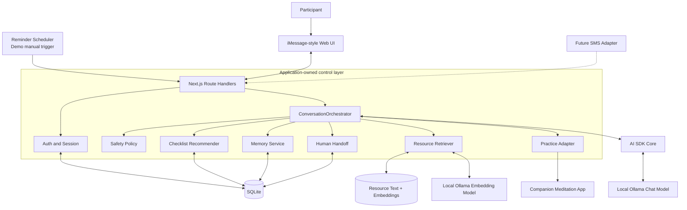
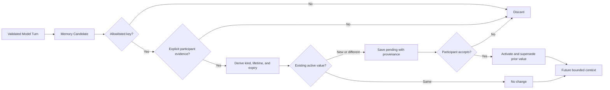
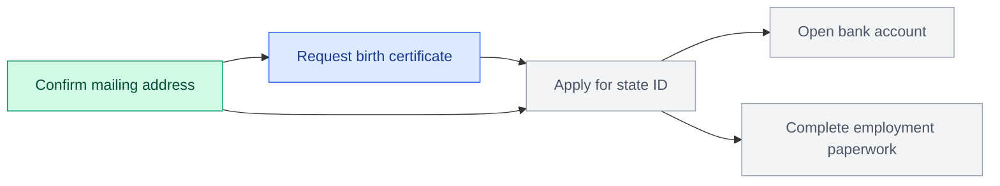
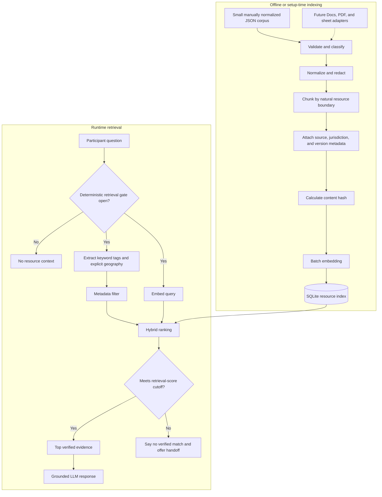
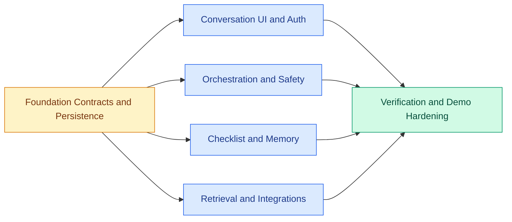

# Mindful Reentry Conversation System

> **Archived design history — superseded.** This document preserves early planning and may contain speculative or outdated choices. Use [TECHNICAL_ARCHITECTURE_V2.md](./TECHNICAL_ARCHITECTURE_V2.md) as the current source of truth for the implemented demo.

## Technical Architecture and Implementation Plan

**Status:** Hackathon MVP<br>
**Date:** October 24, 2026<br>
**Organization:** Boundless Freedom Project (BFP)<br>
**Primary channel:** Browser-based, iMessage-style conversation<br>
**Future channels:** SMS and the companion meditation application

### Reference material

- [Project working document](https://docs.google.com/document/d/1MtN7N7DsfQUSw86CWsr0n4IhAsZHpp4Qlkhi1GwuCyE/edit?tab=t.0#heading=h.qkosz8b4hgx7)
- [Mindfulness Through Re-Entry](https://hackforsocialimpact.notion.site/Mindfulness-Through-Re-Entry-3fe2cb772f1e8032b82cf1aa532fb9e4)
- [Supporting planning document](https://docs.google.com/document/d/1hJJ01tkCfTQUULHo7J_VfxVPbW_gC-diKIcM5JtY5a4/edit?tab=t.0#heading=h.o9xtj18n87gt)
- [HSI Hack Pack 2026](https://hackforsocialimpact.notion.site/HSI-Hack-Pack-2026-3eb2cb772f1e802890d1d4b7769c311a)
- [Boundless Freedom Project](https://boundlessfreedom.org/)

---

## 1. Purpose

Build a low-friction conversational companion for people returning to society after incarceration. The system should help a participant take one manageable next step at a time by combining:

- A familiar text-message experience.
- A dependency-aware reentry checklist.
- Participant-specific progress and memory.
- Retrieval of verified resources.
- Short mindfulness-practice recommendations.
- Proactive, opt-in daily check-ins.
- A consent-based path to human support.

The product is a controlled application containing an LLM. It is **not** an autonomous case manager, therapist, legal adviser, or general-purpose agent.

## 2. Scope and ownership

### This system owns

- The iMessage-style conversation interface.
- Phone-number and PIN-based demo authentication.
- Conversation history and session management.
- LLM orchestration and prompts.
- Participant memory and preferences.
- Checklist progress and next-step recommendations.
- Resource retrieval and grounding.
- Proactive check-in generation.
- Safety routing and human-handoff requests.
- Practice recommendations and deep links.

### The companion application owns

- The complete mindfulness-practice experience.
- Guided audio, breathing, meditation, and visual practice screens.
- Practice-specific media and interaction design.

The two systems integrate through stable `practiceId` values and URLs.

## 3. MVP assumptions

1. One phone number maps to one participant profile.
2. A four-digit PIN adds a demo-level safety layer.
3. The presentation uses one seeded fictional participant.
4. Messages labeled **You** originate from that participant's authenticated session.
5. The interface simulates iMessage in a browser; real iMessage integration is out of scope.
6. The chat model runs locally through Ollama.
7. Participant state is stored locally in SQLite.
8. The resource schema and chunking strategy will be finalized after reviewing the actual resource corpus.
9. Static resources are preprocessed and pre-embedded; user questions are embedded at request time.
10. The demo runs locally on the presentation laptop.

## 4. Success criteria

The MVP is successful when it can reliably demonstrate this end-to-end journey:

1. Andre opens the conversation and enters his PIN.
2. The system recognizes Andre through the configured demo phone number.
3. A simulated morning check-in presents one appropriate priority.
4. Andre says he is anxious about an upcoming appointment.
5. The assistant recommends a short grounding practice.
6. Andre completes or opens the practice.
7. The assistant recommends the next eligible checklist item.
8. Andre confirms completion of a prerequisite task.
9. The dependency engine unlocks the next task.
10. The assistant provides a verified resource or offers a human handoff.

The entire journey must be resettable and repeatable for judging.

## 5. Non-goals

- Production-grade identity verification.
- A native mobile application.
- Real iMessage integration.
- A nationwide reentry-resource database.
- Automated government or benefits form submission.
- A full case-management or CRM system.
- An autonomous multi-agent runtime.
- Permanent storage of every conversation detail.
- Case-specific legal, medical, supervision, or benefits advice.
- Replacing BFP staff, mentors, or community support.

---

## 6. System architecture

### Component diagram



The solid arrows show the MVP path. The dashed SMS path is a future channel adapter and is not required for the hackathon demo.

### Local runtime topology

```text
localhost:3000     Next.js UI and API
local SQLite file  Participant state and resource index
localhost:11434    Ollama
configured URL     Companion meditation application
```

---

## 7. Technology decisions

| Layer | Decision | Reason |
| --- | --- | --- |
| Application | Next.js App Router | One UI/API process and one TypeScript codebase |
| UI | React + Tailwind CSS | Fast implementation of the iMessage-style interface |
| API | Next.js Route Handlers | Stable HTTP contracts for web, future SMS, and app clients |
| Runtime validation | Zod | Shared request, response, and LLM-output schemas |
| Open-source LLM harness | AI SDK Core | Thin model/provider abstraction without surrendering workflow control |
| Workflow | Custom `ConversationOrchestrator` | Explicit, testable, deterministic control flow |
| Chat inference | Ollama on localhost | Local-first model execution |
| Initial chat model | `qwen3:4b` | Small local candidate; use only if the exact pinned tag passes structured-output and latency evals |
| Embeddings | `embeddinggemma` | Local embeddings for resource retrieval |
| Database | Raw SQL over `node:sqlite` | No external service, ORM, or native add-on for the demo |
| PIN hashing | Node `crypto.scrypt` | Built-in salted password hashing primitive |
| Unit tests | Vitest | Fast TypeScript testing |
| End-to-end test | Playwright | Verify the complete golden demo journey |
| Package manager | pnpm with committed lockfile | Fast installation and frozen dependency resolution |

### Runtime and dependency pinning

- Pin the presentation runtime in `.nvmrc` and `package.json#engines`. The current demo machine uses Node `25.9.0`, which supports the required `node:sqlite` API.
- Set `packageManager` in `package.json` and commit `pnpm-lock.yaml`.
- Mark every Route Handler that accesses SQLite or Ollama with `export const runtime = "nodejs"`.
- Use raw SQL migrations for the MVP; do not mix a custom `schema.sql` design with an ORM migration system.
- Commit `.env.example`, but never commit secrets, session tokens, PINs, or a live SQLite database.

### Framework references

- [Next.js Route Handlers](https://nextjs.org/docs/app/getting-started/route-handlers)
- [Next.js backend-for-frontend guidance](https://nextjs.org/docs/app/guides/backend-for-frontend)
- [AI SDK Core](https://ai-sdk.dev/docs/ai-sdk-core/overview)
- [AI SDK OpenAI-compatible provider](https://ai-sdk.dev/providers/openai-compatible-providers)
- [Ollama local API](https://docs.ollama.com/api/introduction)
- [Ollama structured outputs](https://docs.ollama.com/capabilities/structured-outputs)
- [Ollama tool calling](https://docs.ollama.com/capabilities/tool-calling)
- [Ollama embeddings](https://docs.ollama.com/capabilities/embeddings)
- [Node SQLite](https://nodejs.org/api/sqlite.html)

## 8. Agent-harness decision

Use **AI SDK Core as a thin open-source model harness** and retain an explicit application-owned workflow.

Do not use an autonomous `ToolLoopAgent`, LangGraph, LangChain, or Mastra in the MVP. Those frameworks become valuable when a model must choose an unknown sequence of tools, pause and resume long-running work, delegate to other agents, or recover complex workflow checkpoints. This product has a short, known, safety-sensitive turn pipeline.

The runtime is therefore:

```text
AI SDK Core
    -> provider abstraction and structured generation

ConversationOrchestrator
    -> workflow, policy, persistence, and side effects

MemoryService / ChecklistService / ResourceRetriever
    -> authoritative domain behavior
```

The LLM proposes actions. Application services approve and execute them.

### AI SDK-to-Ollama transport

Use the official AI SDK OpenAI-compatible adapter against Ollama's OpenAI-compatible local endpoint:

```ts
import { createOpenAICompatible } from "@ai-sdk/openai-compatible";

const ollamaBaseUrl = process.env.OLLAMA_BASE_URL!.replace(/\/+$/, "");

export const ollamaProvider = createOpenAICompatible({
  name: "ollama",
  baseURL: `${ollamaBaseUrl}/v1`,
  apiKey: "ollama-local",
  supportsStructuredOutputs: true,
});
```

`OLLAMA_BASE_URL` is the server root, such as `http://localhost:11434`; it must not include `/api` when used with this adapter. Pin compatible major versions of `ai` and `@ai-sdk/openai-compatible` and confirm the integration with startup smoke tests.

The minimum production dependencies are:

```text
next
react
react-dom
ai
@ai-sdk/openai-compatible
zod
```

Development dependencies include `tailwindcss`, `typescript`, `tsx`, `vitest`, and `@playwright/test`. Pin compatible major versions and use `pnpm install --frozen-lockfile` on the demo machine.

## 9. Model and embedding gateways

All model-specific behavior sits behind two interfaces:

```ts
export interface ModelGateway {
  generateTurn(input: ModelTurnInput): Promise<AssistantTurn>;
}

export interface EmbeddingGateway {
  embed(inputs: string[]): Promise<number[][]>;
}
```

Initial implementations:

```text
OllamaModelGateway
OllamaEmbeddingGateway
```

`OllamaModelGateway` uses `ollamaProvider.chatModel(OLLAMA_CHAT_MODEL)`. `OllamaEmbeddingGateway` uses the corresponding embedding model exposed through the compatible provider; if embedding compatibility fails the preflight smoke test, it may call Ollama's official `/api/embed` endpoint behind the same `EmbeddingGateway` interface. No domain module knows which transport is used.

The chat implementation uses the schema as the generation target rather than parsing free-form JSON:

```ts
import { generateText, Output } from "ai";
import { assistantTurnSchema } from "@/contracts/assistant-turn";

const result = await generateText({
  model: ollamaProvider.chatModel(process.env.OLLAMA_CHAT_MODEL!),
  output: Output.object({ schema: assistantTurnSchema }),
  prompt: promptBuilder.build(input),
  temperature: 0,
  maxOutputTokens: 900,
  maxRetries: 0,
  abortSignal: AbortSignal.timeout(Number(process.env.MODEL_TIMEOUT_MS)),
  providerOptions: {
    ollama: {
      reasoningEffort: "none",
      strictJsonSchema: true,
    },
  },
});

return result.output;
```

Pin an AI SDK version that supports this call shape, and make this exact path part of preflight. If the configured Ollama version or selected model ignores either provider option, fail preflight rather than silently presenting an untested configuration.

This allows a later switch to another local or hosted provider without changing the conversation, checklist, memory, or retrieval layers.

Use non-streaming structured generation for the MVP. The UI displays a typing indicator and then renders a complete validated bubble. Partial JSON is never shown or persisted.

Generation settings are fixed and evaluated rather than left to model defaults:

- Temperature `0`.
- Thinking/reasoning disabled for the turn generator.
- Bounded output tokens and bounded schema fields.
- Abortable request timeout with no unbounded transport retries.
- One normal generation plus at most one explicit schema/policy-repair generation.
- Exact chat and embedding model tags recorded by preflight and logs.

---

## 10. Authentication and session flow

### UI assumption

The demo UI is configured with one fictional phone number. The conversation header displays a masked identifier:

```text
Demoing as Andre - ***-0123
```

In the thread, **You** means the participant associated with the current authenticated session. It is a presentation label, not a second identity mechanism; the server derives identity only from the session cookie.

### Sign-in flow

```text
Open demo
  -> fixed demo phone identifies Andre
  -> local assistant-style bubble asks, "Can you enter your 4-digit PIN?"
  -> conversation composer switches to masked numeric PIN mode
  -> POST /api/auth/pin
  -> verify salted PIN hash
  -> issue opaque HTTP-only session cookie
  -> load Andre's conversation and checklist
```

The PIN step looks conversational, but it remains an authentication interaction. The prompt bubble is local, reviewed UI copy rather than an LLM message. The submitted digits are masked and sent directly to `/api/auth/pin`; they are never rendered as a participant bubble.

The PIN must:

- Never appear as a chat message.
- Never enter conversation history.
- Never be logged.
- Never be sent to the LLM.
- Be stored only as a salted `scrypt` hash.
- Be protected by a small failed-attempt limit.

Subsequent chat requests use the session cookie, not the phone number or PIN.

On successful PIN verification, generate a random 256-bit opaque session token with `crypto.randomBytes(32)`. Send the raw value only in the cookie and store only its SHA-256 hash in `sessions`; no `SESSION_SECRET` is needed. Sessions expire after eight hours. The cookie uses `Path=/`, `HttpOnly`, `SameSite=Strict`, and `Secure` outside localhost. Five failed attempts lock PIN verification for 15 minutes in the demo.

`db:seed` reads the fictional credential from uncommitted `DEMO_PIN`, hashes it, and never persists the clear PIN outside the local environment. A successful login atomically clears `failed_attempts` and `locked_until`.

### Conversation UI behavior

- Use familiar left/right message bubbles, readable timestamps, a fixed composer, and a clear **You** label.
- Before authentication, show an assistant-style prompt asking for the PIN and temporarily convert the composer into a masked four-digit numeric field.
- Do not show the entered PIN as a **You** bubble; on success, remove the authentication prompt state and display the participant's real thread.
- Render checklist, practice, resource, memory-confirmation, and handoff actions as server-supplied cards or quick-action buttons.
- Disable duplicate sends while a `clientMessageId` is in flight, but allow a safe retry with the same ID.
- Show a typing indicator during non-streaming generation and a calm fallback message on timeout.
- Display resource provenance near the relevant answer without overwhelming the conversation.
- Meet keyboard, screen-reader, contrast, reduced-motion, and large-text needs; do not rely on bubble color alone to identify the speaker.

---

## 11. Conversation orchestration

### Turn sequence diagram

```mermaid
sequenceDiagram
    actor Participant
    participant UI as iMessage UI
    participant API as Chat Route
    participant O as ConversationOrchestrator
    participant DB as SQLite
    participant R as Resource Retriever
    participant M as Local LLM

    Participant->>UI: Send message
    UI->>API: POST /api/chat/messages + clientMessageId
    API->>DB: Insert or load participant message
    DB-->>API: Prior completed response or persisted message
    alt Completed retry
        API-->>UI: Return the previously committed response
    else New or incomplete turn
        API->>O: Authenticated session + persisted message
        O->>O: Deterministic safety precheck
        alt Urgent deterministic match
            O->>DB: Store reviewed static safety reply
            DB-->>O: Persisted result
            Note over O,M: Retrieval and model inference are skipped
        else Normal or concern path
            O->>DB: Load profile, tasks, memory, recent messages
            DB-->>O: Structured participant context
            O->>O: Compute eligible checklist candidates
            opt Deterministic resource-retrieval gate is open
                O->>R: Search verified resources
                R-->>O: Ranked resource evidence
            end
            alt Resource search requested but no verified match
                O->>DB: Store server-owned no-match reply and handoff offer
                DB-->>O: Persisted result
            else Retrieval skipped or verified matches found
                O->>M: Bounded prompt + strict JSON schema
                M-->>O: Reply + proposed actions
                O->>O: Zod, grounding, and action-policy validation
                O->>DB: Atomically store reply and approved mutations
                DB-->>O: Persisted result
            end
        end
        O-->>API: Validated response and UI actions
        API-->>UI: Assistant message
    end
    UI-->>Participant: Complete chat bubble
```

### Per-turn pipeline

```text
1. Validate authenticated session
2. Validate clientMessageId and message text
3. In a short transaction, insert-or-load the participant message
4. Return the existing committed response when this is a retry
5. Run the deterministic safety precheck
6. If urgent, persist reviewed static safety copy and stop
7. Load profile, preferences, active tasks, structured memory, and recent messages
8. Compute eligible checklist candidates
9. Run the deterministic retrieval gate and search only when it opens
10. If a requested search has no verified match, persist the reviewed no-match/handoff response and stop
11. Build a bounded prompt from approved context
12. Generate one schema-constrained model response
13. Validate Zod shape, grounding IDs, and proposed actions
14. Map approved proposals to server-owned UI actions
15. In a second short transaction, persist the assistant message and approved mutations
16. Return the persisted response
```

Never keep a SQLite transaction open while calling Ollama or generating embeddings. The first transaction deduplicates and persists the participant message. Inference runs outside a transaction. The final transaction rechecks whether a response already exists, then atomically writes the assistant message, approved memory changes, and any other permitted domain events. A process-local single-flight keyed by `(conversationId, clientMessageId)` prevents duplicate inference in the single-process demo; database uniqueness and the final recheck remain authoritative.

Urgent, no-match, normal, and fallback writes all use that same final response-exists recheck; `commitAssistantOnly` is not a weaker persistence path.

### Failure behavior

- Set transport retries to zero for the demo and allow at most one separately coded schema/policy-repair generation.
- If inference times out or the repair response is invalid, perform zero domain mutations.
- Persist a neutral deterministic fallback as the assistant response to the same participant message.
- Offer human help when a verified answer is unavailable.
- Log the failure using an opaque request ID without sensitive content.

The urgent path is not a fallback and never depends on the local model. It returns BFP-reviewed, US-demo-only emergency copy and server-owned actions. A lower-risk deterministic result may be escalated by the model but never downgraded.

### Orchestrator outline

```ts
async function handleMessage(
  session: AuthenticatedSession,
  input: { clientMessageId: string; text: string },
): Promise<ChatResponse> {
  const incoming = await repositories.acceptOrLoadIncoming(
    session.userId,
    input,
  );
  if (incoming.completedResponse) return incoming.completedResponse;

  const safety = safetyPolicy.precheck(incoming.message.text);
  if (safety.risk === "urgent") {
    return repositories.commitAssistantOnly(
      incoming.message,
      safetyPolicy.reviewedUrgentResponse(),
    );
  }

  const context = await contextBuilder.load(
    session.userId,
    incoming.message.id,
  );
  const candidates = await checklistService.recommendNext(session.userId, context);
  const retrievalPlan = retrievalPlanner.plan(incoming.message.text, context);
  const retrieval = retrievalPlan.enabled
    ? await resourceRetriever.search(retrievalPlan)
    : { status: "not_requested", query: null, resources: [] };

  if (retrieval.status === "no_match") {
    return repositories.commitAssistantOnly(
      incoming.message,
      responsePolicy.noVerifiedResourceMatch(retrieval.query),
    );
  }

  const proposal = await modelGateway.generateTurn({
    text: incoming.message.text,
    safety,
    context,
    resources: retrieval.resources,
    checklistCandidates: candidates,
  });

  const approved = actionPolicy.validate(proposal, {
    userId: session.userId,
    retrieval,
    checklistCandidates: candidates,
  });

  return repositories.commitTurn(incoming.message, approved);
}
```

---

## 12. Prompt design

Prompt composition is layered and versioned:

1. **Invariant safety policy** - forbidden behavior, crisis routing, and human-handoff boundaries.
2. **BFP voice** - plain, respectful, humanizing, concise, and nonjudgmental.
3. **Participant context** - preferred name, language, reminder preferences, and stable approved memories.
4. **Checklist context** - recent completions, current goal, eligible candidates, and blockers.
5. **Retrieved evidence** - verified resource excerpts with IDs and source metadata, clearly delimited as untrusted data.
6. **Recent conversation** - a bounded message window; the MVP does not generate conversation summaries.
7. **Output contract** - exact JSON schema and allowed action types.

The prompt never includes the PIN or full phone number.

Retrieved text is evidence, not instruction. Strip active markup, delimit every excerpt, and tell the model never to follow instructions found inside a resource. Render the model's reply as plain text; links, phone numbers, citations, and resource cards come only from validated server records.

## 13. Structured model output

```ts
import { z } from "zod";

const modelProposedActionSchema = z.discriminatedUnion("type", [
  z.object({
    type: z.literal("offer_practice"),
    practiceId: z.string().min(1).max(80),
  }).strict(),
  z.object({
    type: z.literal("propose_task_completion"),
    taskId: z.string().min(1).max(80),
  }).strict(),
  z.object({
    type: z.literal("recommend_next_task"),
    taskId: z.string().min(1).max(80),
  }).strict(),
  z.object({
    type: z.literal("offer_handoff"),
    reason: z.string().min(1).max(160),
  }).strict(),
  z.object({ type: z.literal("noop") }).strict(),
]);

const modelActionsSchema = z
  .array(modelProposedActionSchema)
  .max(3)
  .superRefine((actions, context) => {
    if (actions.length > 1 && actions.some((action) => action.type === "noop")) {
      context.addIssue({
        code: z.ZodIssueCode.custom,
        message: "noop must be the only action",
      });
    }
  });

const memoryCandidateSchema = z.object({
  key: z.enum([
    "preferred_practice_type",
    "communication_preference",
    "accessibility_need",
    "participant_goal",
    "temporary_obstacle",
  ]),
  value: z.string().min(1).max(200),
  sourceQuote: z.string().min(1).max(160),
}).strict();

export const assistantTurnSchema = z.object({
  reply: z.string().min(1).max(800),
  intent: z.enum([
    "check_in",
    "task_help",
    "resource_search",
    "practice",
    "handoff",
    "general",
  ]),
  risk: z.enum(["none", "concern", "urgent"]),
  actions: modelActionsSchema,
  memoryCandidates: z.array(memoryCandidateSchema).max(2),
  usedResourceIds: z.array(z.string().min(1).max(80)).max(3),
}).strict();

export type AssistantTurn = z.infer<typeof assistantTurnSchema>;
```

`AssistantTurn` is the model-facing proposal. It is not returned directly to the browser. An application-owned mapper produces server-controlled actions:

```ts
type ChatUiAction =
  | PracticeUiAction
  | { type: "resources"; resources: ResourceCard[] }
  | { type: "confirm_task_completion"; task: TaskCard }
  | { type: "next_task"; task: TaskCard }
  | { type: "handoff"; reason: string; demoOnly: true }
  | { type: "memory_confirmation"; memoryId: string; prompt: string }
  | { type: "emergency_call"; label: string; phoneNumber: string };
```

The mapper supplies titles, contact details, URLs, and citations from trusted database records. `usedResourceIds` is the single canonical source for both resource cards and citations; a model `noop` proposal creates no browser action.

Action-policy validation ensures that:

- Task IDs belong to the authenticated participant.
- Recommended tasks are in the computed eligible set.
- `usedResourceIds` is a subset of a successful current retrieval result, and is empty when retrieval was skipped; citations and cards are built server-side.
- Practice IDs exist in the synced practice catalog.
- `propose_task_completion` only renders **Mark complete?** and never changes task state.
- `offer_handoff` only renders the consent flow; only `POST /api/handoff` creates the local demo request.
- Safety signals can be escalated but never downgraded.
- Memory candidates satisfy the memory allowlist.
- `sourceQuote` is an exact normalized span of the current participant message; invalid candidates are discarded.
- Memory kind, lifetime, sensitivity, expiry, and confirmation requirement are derived by server policy rather than accepted from the model.
- Unknown fields, arbitrary URLs, and model-authored contact details are rejected.

Invalid memory candidates are dropped without affecting an otherwise safe turn. Invalid grounding, unsupported contact details, or unknown/non-eligible task or practice IDs trigger the single validation-repair attempt; if they remain invalid, the entire turn uses the deterministic fallback with zero domain mutations.

If a validated model response raises risk to `urgent`, discard the entire model result—including reply, actions, resource references, and memory candidates—and commit only the same BFP-reviewed urgent message and server-owned emergency actions used by the deterministic short-circuit.

---

## 14. Personal memory system

### Memory lifecycle diagram



Personal memory is a dedicated subsystem, not raw chat history and not framework-owned agent memory.

### Context categories

1. **Recent conversation:** bounded recent messages.
2. **Structured profile:** preferred name, language, timezone, and reminder preferences.
3. **Participant state:** checklist progress, appointments, and handoff state.
4. **Personal memory:** stable preferences and useful participant-provided background.

Tasks, identity, and resources are not stored as personal memories.

### Memory lifecycle

```text
Model proposes memory candidate
  -> MemoryService checks allowlisted key
  -> server verifies sourceQuote against the current participant message
  -> server attaches sourceMessageId and discards the quote
  -> derive sensitivity and lifetime from application policy
  -> compare with the existing active value
  -> if new or different, store as pending_confirmation
  -> activate and supersede only after an explicit Yes response
```

### Appropriate long-term memories

- Preferred mindfulness-practice type.
- Communication preferences.
- Stable accessibility needs.
- Explicitly stated goals.

Preferred language, timezone, and reminder schedule are authoritative fields in `users` or `reminder_preferences`; they are changed only through explicit settings flows and are never duplicated in `memories`.

### Short-lived context

- Anxiety about tomorrow's appointment.
- A task the participant intends to finish this week.
- A temporary obstacle or wait state.

Short-lived context may be used within the current bounded conversation without persistence. If it should appear in future turns, it receives an expiration time or task link and follows the same confirmation flow.

For the MVP, a pending memory is presented as a server-generated confirmation card with **Yes** and **No** actions. `POST /api/memories/:id/decision` activates or rejects it. The model never decides that its own proposed memory is confirmed.

### Never store as ordinary memory

- PINs or authentication data.
- Model guesses about the participant.
- Diagnoses or legal conclusions.
- Unnecessary sensitive information.
- Every detail from every conversation.

### Memory service

```ts
type MemoryQuery = {
  keys?: MemoryKey[];
  kinds?: MemoryKind[];
  status: "active";
  now: Date;
  limit: number;
};

interface MemoryService {
  retrieveForContext(userId: string, query: MemoryQuery): Promise<Memory[]>;
  evaluate(
    userId: string,
    sourceMessageId: string,
    candidates: MemoryCandidate[],
  ): Promise<MemoryDecision[]>;
  commit(userId: string, decisions: MemoryDecision[]): Promise<void>;
  decide(userId: string, memoryId: string, accepted: boolean): Promise<void>;
  forget(userId: string, memoryId: string): Promise<void>;
}
```

For the MVP, memory retrieval uses structured keys, type, recency, and expiration. Do not embed personal memory unless the volume later justifies semantic retrieval.

Recent messages remain separate from memory and are included only as a bounded window. The demo retains raw messages until `POST /api/demo/reset`; no automatic summarizer exists. A real pilot requires a BFP-approved retention and deletion policy before collecting participant data.

---

## 15. Dependency-aware checklist

### Example dependency graph



In this example, the mailing-address prerequisite is complete, the birth-certificate task is the next eligible recommendation, and downstream tasks remain locked until their prerequisites are satisfied. The real graph will be built from the provided checklist rather than inferred from this example.

The checklist is a directed dependency graph stored as structured application data. The LLM does not infer task order from raw prose on every turn.

### Task template

```ts
type TaskTemplate = {
  id: string;
  title: string;
  category: string;
  description?: string;
  basePriority: number;
  estimatedMinutes?: number;
  resourceTags: string[];
  appliesWhen?: Record<string, unknown>;
};
```

### Dependency types

- `required`: prerequisite must be complete; this is the only P0 behavior needed for the seeded golden journey.
- `recommended`: helpful but not blocking; reserved in the schema and implemented only if the supplied checklist needs it.
- `alternative`: any one of a set can satisfy the dependency; stretch behavior after the required-edge journey passes.

Likewise, `appliesWhen` remains an interface seam for future participant-specific rules. P0 fixtures use explicit seeded tasks and required edges rather than a generic rules engine.

### Participant task status

```text
not_started
in_progress
waiting
blocked
completed
not_applicable
```

Availability is computed from dependencies rather than stored as an independent truth.

### Recommendation algorithm

1. Remove completed and non-applicable tasks.
2. Evaluate required and alternative prerequisites.
3. Exclude blocked or waiting tasks.
4. Apply participant-specific conditions.
5. Sort eligible tasks with the deterministic ordering below.
6. Return at most three candidates.

Deterministic ordering, evaluated lexicographically:

```text
1. due urgency: overdue, due today, due soon, then no due date
2. continuity: in-progress before not-started
3. number of downstream tasks unlocked, descending
4. base priority, descending
5. stable task ID, ascending
```

This avoids combining unrelated, unscaled numbers. The participant sees a humane reason, not the ranking tuple.

### Checklist context supplied to the LLM

```json
{
  "completedRecently": [
    { "id": "confirm-mailing-address", "title": "Confirm a mailing address" }
  ],
  "currentGoal": "Get identification documents",
  "recommendedCandidates": [
    {
      "id": "obtain-birth-certificate",
      "title": "Request a birth certificate",
      "reason": "It is required before applying for a state ID.",
      "estimatedMinutes": 20
    }
  ],
  "blockedTasks": [
    {
      "id": "apply-state-id",
      "title": "Apply for a state ID",
      "blockedBy": ["obtain-birth-certificate"]
    }
  ]
}
```

The LLM may recommend only a task included in `recommendedCandidates`.

### Conversational completion flow

```text
Participant: "I received my birth certificate."
  -> model proposes task completion
  -> server renders a "Mark complete?" action
  -> participant explicitly activates that action
  -> POST /api/tasks/:id/complete validates and records completion
  -> dependency graph recalculates
  -> newly available task becomes a recommendation candidate
```

Only `POST /api/tasks/:id/complete` changes checklist status; a chat turn never does so implicitly. The same recommender powers direct questions, proactive morning messages, and recommendations after task completion.

---

## 16. Resource retrieval

### Indexing and runtime retrieval diagram



Do not finalize a universal resource schema until the complete corpus is available. Different source types may require different normalized records.

For the two-day MVP, manually normalize a small, demo-relevant set into reviewed JSON rather than building general Google Docs, PDF, spreadsheet, and web crawlers. Each record should preserve the source and include an ID, title, short description, category, tags, services, explicit jurisdiction, eligibility notes, trusted contact fields, source URL, review status, and `reviewedAt`. Additional ingestion adapters are stretch work after the chat flow is stable.

Initial normalized envelope:

```ts
type NormalizedResource = {
  id: string;
  title: string;
  summary: string;
  category: string;
  tags: string[];
  services: string[];
  jurisdiction: {
    country: "US";
    states?: string[];
    counties?: string[];
    postalCodes?: string[];
  };
  eligibilityNotes?: string[];
  contact: {
    phone?: string;
    url?: string;
    address?: string;
    hours?: string;
  };
  source: {
    uri: string;
    sourceType: "website" | "document" | "spreadsheet" | "manual";
    accessedAt: string;
  };
  verification: {
    status: "reviewed";
    reviewedAt: string;
    reviewer?: string;
  };
};
```

Adjust optional fields after inspecting the supplied corpus, but preserve provenance, jurisdiction, verification, and contact data as structured fields. Do not bury phone numbers or URLs only inside embedded prose.

### Ingestion pipeline

```text
Reviewed normalized JSON
  -> validate and classify
  -> extract text and structured fields
  -> remove irrelevant or sensitive content
  -> chunk at natural headings or resource boundaries
  -> attach source, jurisdiction, and version metadata
  -> calculate versioned content hash
  -> generate embeddings in batches
  -> store chunks and vectors in SQLite
```

Only new or changed chunks are re-embedded. The cache key includes normalized text, embedding-model tag and digest, embedding dimensions, chunker version, and index version.

### Minimum storage envelope

```text
resource_documents
- id
- source_uri
- source_type
- title
- category
- jurisdiction_json
- verification_status
- metadata_json
- content_hash
- reviewed_at

resource_chunks
- id
- document_id
- chunk_index
- text
- metadata_json
- embedding_json
- content_hash

resource_index_metadata
- index_version
- embedding_model
- embedding_model_digest
- embedding_dimensions
- chunker_version
- indexed_at
```

The same exact embedding model tag and digest are used for indexing and query embeddings. `demo:preflight` fails on mixed vector dimensions, mixed index versions, a runtime/index model mismatch, or stale normalized content.

### Runtime retrieval

Keep the result state explicit so a skipped search cannot be confused with an unsuccessful search:

```ts
type RetrievalResult =
  | { status: "not_requested"; query: null; resources: [] }
  | { status: "no_match"; query: string; resources: [] }
  | { status: "matches"; query: string; resources: RetrievedResource[] };
```

```text
Participant question
  -> deterministic gate for resource language or an active resource flow
  -> extract exact category/tag terms and explicitly provided geography
  -> metadata filtering
  -> embed the question
  -> cosine-similarity ranking
  -> keyword/exact-term boost
  -> evaluation-calibrated retrieval-score cutoff
  -> top verified chunks
  -> grounded response
```

Retrieve at most three chunks from at most two documents for a normal response.

The retrieval gate uses an allowlisted set of resource terms and active UI state—for example, explicit requests to find housing, employment, food, transportation, identification, benefits, a phone number, an address, or local help. Category and location extraction is deterministic; it does not require a classifier call. Location filtering uses only profile geography the participant explicitly supplied or geography stated in the current message. Never infer location from timezone. If the gate is closed, do not start the embedding model.

For a few hundred chunks, load embeddings into memory and compute cosine similarity directly. Do not add a vector database for the MVP.

### Grounding rule

The model may explain retrieved resources, but it may not invent a program, eligibility rule, deadline, address, phone number, or service. `usedResourceIds` must be a subset of a `matches` result. The server creates citations and contact cards from stored records rather than model text. A `no_match` result bypasses the model and returns reviewed, server-owned wording that says no verified answer is available and offers a human handoff.

### Information that does not use RAG

| Information | Retrieval method |
| --- | --- |
| Participant profile | Direct SQLite query |
| Checklist and dependencies | Direct SQLite query and graph computation |
| Approved personal memory | Structured query by key/type/recency |
| Safety policy | Application code and invariant prompt |
| Recent conversation | Bounded direct context |
| Public resource corpus | Hybrid semantic and metadata retrieval |

---

## 17. Proactive check-ins

A scheduler, not the LLM, initiates messages.

```ts
async function createMorningCheckIn(
  userId: string,
  now: Date,
): Promise<OutboundMessage>;
```

The service:

1. Checks reminder consent.
2. Respects timezone and quiet hours.
3. Enforces one morning event per participant and local date.
4. Calls the checklist recommender.
5. Selects one eligible high-value task.
6. Uses a reviewed template that asks how the participant feels and offers one manageable next step.
7. Stores the outbound message.
8. Sends through a channel adapter.

For the hackathon, `POST /api/demo/morning` invokes this flow and returns the complete persisted `OutboundMessage`, which the browser appends directly. Repeated calls for the same participant and local date return the same message instead of creating duplicates. A real scheduler or SMS provider can call the same service later.

Shared-device notifications should remain discreet. Avoid notification text that reveals incarceration, parole, mental-health, benefits, or medical information.

---

## 18. Practice-app integration

```ts
type PracticeUiAction = {
  type: "practice";
  practiceId: string;
  title: string;
  durationSeconds: number;
  url: string;
  fallbackText: string;
};
```

Example:

```json
{
  "type": "practice",
  "practiceId": "three-breaths-60s",
  "title": "Three Intentional Breaths",
  "durationSeconds": 60,
  "url": "http://localhost:3001/practice/three-breaths-60s",
  "fallbackText": "Put both feet down and take one slow breath."
}
```

`offer_practice` is the model proposal; `PracticeUiAction` is the trusted browser contract. Build its absolute URL from `PRACTICE_APP_BASE_URL` and a catalog-owned path. Validate `practiceId` against a locally synchronized catalog so the model cannot invent practice links. If the companion app is unavailable, show `fallbackText` in the conversation.

---

## 19. Safety and human handoff

BFP is not an emergency or crisis-response service.

For the seeded US demo, BFP-approved static copy may direct someone in an immediate mental-health crisis to call or text the [988 Lifeline](https://988lifeline.org/) and someone in immediate danger or a medical emergency to call 911. These numbers and messages must be localized before any non-US use.

The deterministic precheck is a limited demo guard based on reviewed phrases and direct statements. It is not a reliable crisis classifier, and the 4B local model is not treated as one. An urgent match immediately returns reviewed static copy and server-owned call actions; it skips retrieval and LLM generation.

The application must offer a human handoff when:

- The participant requests a person.
- The participant requests mentorship or community connection.
- The question requires case-specific legal, medical, or supervision advice.
- The participant asks for an individualized eligibility determination, disputes an eligibility result, or needs interpretation beyond a verified source.
- A housing, employment, or benefits search has no verified match or requires staff judgment.
- The participant appears unable to use the application.
- The system lacks a verified answer.
- A safety concern is detected.

General navigation to verified housing, employment, food, transportation, identification, or benefits resources remains in scope and does not automatically require handoff.

The handoff flow must:

1. Explain whether and who will receive the request; in the demo, state that nobody is notified.
2. Ask for consent.
3. Confirm a safe contact method and time.
4. Collect only necessary information.
5. Create a concise summary.
6. Generate a neutral reference number.
7. Avoid promising immediate or 24-hour response.

Deterministic safety rules run before the model. The model may raise the risk level but may never lower a deterministic escalation.

For the hackathon, handoff is a **local demo queue only**. It creates a SQLite record and reference number so the flow can be demonstrated, but it does not contact or notify BFP staff. The UI must say this plainly before consent and after submission.

---

## 20. Data model

### Core tables

```text
users
- id
- phone_e164 (unique)
- preferred_name
- language
- timezone
- state (nullable)
- county (nullable)
- postal_code (nullable)
- created_at

pin_credentials
- user_id
- pin_hash
- salt
- failed_attempts
- locked_until
- updated_at

sessions
- id
- user_id
- token_hash (unique)
- expires_at
- last_used_at
- created_at

conversations
- id
- user_id
- channel
- created_at
- updated_at

messages
- id
- conversation_id
- client_message_id (nullable; participant messages only)
- in_reply_to_message_id (nullable; assistant messages only)
- role
- kind (`inbound`, `reply`, or `proactive`)
- text
- metadata_json
- created_at
- unique (conversation_id, client_message_id)
- unique (conversation_id, in_reply_to_message_id)

task_templates
- id
- title
- category
- description
- base_priority
- estimated_minutes
- resource_tags_json
- applies_when_json

task_dependencies
- task_id
- prerequisite_task_id
- dependency_type
- alternative_group

user_tasks
- user_id
- task_id
- status
- due_at
- started_at
- completed_at
- blocked_reason
- participant_notes

memories
- id
- user_id
- key
- value
- kind
- source_message_id
- sensitivity
- status
- created_at
- updated_at
- expires_at
- supersedes_memory_id

reminder_preferences
- user_id
- enabled
- local_time
- quiet_hours_start
- quiet_hours_end

outbound_messages
- id
- user_id
- message_id
- kind
- local_date
- metadata_json
- created_at
- unique (user_id, kind, local_date)

handoffs
- id
- user_id
- client_request_id
- reason
- consented_at
- safe_contact_method
- safe_contact_time
- summary
- reference_number
- status
- created_at
- unique (user_id, client_request_id)

practice_catalog
- practice_id
- title
- duration_seconds
- path
- fallback_text

resource_documents
resource_chunks
resource_index_metadata

schema_migrations
- version
- applied_at
```

Use UUIDs internally. The phone number identifies the demo participant but is not used as a foreign key. Optional geography is populated only from explicit participant input or seeded demo data. Memory `status` is one of `pending_confirmation`, `active`, `rejected`, or `superseded`; the server assigns `source_message_id`.

Cache one process-wide `DatabaseSync` connection on `globalThis` so Next.js development hot reload does not create extra handles. Enable foreign keys and WAL mode, and set a finite `busy_timeout`. Use prepared statements and `BEGIN IMMEDIATE` for PIN counters, message insert-or-load, final response rechecks, and demo reset. Track applied SQL in `schema_migrations`.

Database `CHECK` constraints enforce: `inbound` participant messages have `client_message_id` and no reply target; `reply` assistant messages have `in_reply_to_message_id` and no client ID; and `proactive` assistant messages have neither. The two message uniqueness constraints make chat idempotent. A reused `clientMessageId` with different normalized text returns `409`; an identical retry loads its existing assistant response. `messages.metadata_json` stores the validated, versioned `ChatUiAction[]`, citations, and fallback metadata so `GET /api/bootstrap` can reconstruct the thread after refresh.

### Demo privacy boundary

Use only seeded fictional participant data during the hackathon. Do not ask judges or testers to enter real legal, medical, supervision, incarceration, benefits, or authentication information. Local Ollama keeps model traffic on the presentation laptop, but that alone does not make the demo production-safe. A pilot would additionally require BFP-approved consent and retention rules, encryption and backup policy, access control, audit review, secure deployment/TLS, incident response, and a formal safety evaluation.

---

## 21. API contracts

The Foundation workstream exports strict Zod schemas and inferred TypeScript types for every boundary. These shared shapes are frozen before route and UI work begins:

```ts
const taskStatusSchema = z.enum([
  "not_started", "in_progress", "waiting", "blocked",
  "completed", "not_applicable",
]);

const taskCardSchema = z.object({
  id: z.string().min(1).max(80),
  title: z.string().min(1).max(160),
  status: taskStatusSchema,
  reason: z.string().max(240).optional(),
  estimatedMinutes: z.number().int().positive().max(480).optional(),
}).strict();

const citationSchema = z.object({
  resourceId: z.string().min(1).max(80),
  title: z.string().min(1).max(160),
  sourceUri: z.string().url(),
  reviewedAt: z.string().datetime(),
}).strict();

const resourceCardSchema = z.object({
  id: z.string().min(1).max(80),
  title: z.string().min(1).max(160),
  summary: z.string().min(1).max(500),
  category: z.string().min(1).max(80),
  phone: z.string().max(40).optional(),
  url: z.string().url().optional(),
  address: z.string().max(240).optional(),
}).strict();

const chatUiActionSchema = z.discriminatedUnion("type", [
  z.object({
    type: z.literal("practice"),
    practiceId: z.string().min(1).max(80),
    title: z.string().min(1).max(160),
    durationSeconds: z.number().int().positive().max(3600),
    url: z.string().url(),
    fallbackText: z.string().min(1).max(300),
  }).strict(),
  z.object({
    type: z.literal("resources"),
    resources: z.array(resourceCardSchema).min(1).max(2),
  }).strict(),
  z.object({
    type: z.literal("confirm_task_completion"),
    task: taskCardSchema,
  }).strict(),
  z.object({ type: z.literal("next_task"), task: taskCardSchema }).strict(),
  z.object({
    type: z.literal("handoff"),
    reason: z.string().min(1).max(160),
    demoOnly: z.literal(true),
  }).strict(),
  z.object({
    type: z.literal("memory_confirmation"),
    memoryId: z.string().uuid(),
    prompt: z.string().min(1).max(240),
  }).strict(),
  z.object({
    type: z.literal("emergency_call"),
    label: z.string().min(1).max(80),
    phoneNumber: z.string().min(3).max(20),
  }).strict(),
]);

const messageSchema = z.object({
  id: z.string().uuid(),
  role: z.enum(["participant", "assistant"]),
  text: z.string().min(1).max(2000),
  createdAt: z.string().datetime(),
  actions: z.array(chatUiActionSchema).max(3),
  citations: z.array(citationSchema).max(3),
  fallbackUsed: z.boolean(),
}).strict();

const outboundMessageSchema = z.object({
  message: messageSchema,
  kind: z.literal("morning_check_in"),
  localDate: z.string().regex(/^\d{4}-\d{2}-\d{2}$/),
}).strict();

const errorResponseSchema = z.object({
  error: z.object({
    code: z.string().min(1).max(80),
    message: z.string().min(1).max(240),
    requestId: z.string().uuid(),
    retryAfterSeconds: z.number().int().nonnegative().optional(),
  }).strict(),
}).strict();
```

Additional route schemas are:

| Schema | Exact fields |
| --- | --- |
| `PinRequest` | `phoneNumber: E.164 string`, `pin: exactly 4 digits` |
| `AuthSuccess` | `participant: { preferredName, maskedPhone }` |
| `BootstrapResponse` | `participant`, `messages: Message[]`, `tasks: TaskCard[]`, `recommendedTasks: TaskCard[]`, `features: { demoMode, practiceAvailable }` |
| `ChatRequest` | `clientMessageId: UUID`, `text: 1-2,000 character string` |
| `ChatResponse` | `message: Message`, `meta: { requestId: UUID, fallbackUsed: boolean }` |
| `TaskCompletionResponse` | `completedTask: TaskCard`, `newlyUnlocked: TaskCard[]` |
| `MemoryDecisionRequest` | `accepted: boolean` |
| `MemoryDecisionResponse` | `memoryId: UUID`, `status: active \| rejected` |
| `HandoffRequest` | `clientRequestId: UUID`, `consent: literal true`, `reason`, `safeContactMethod`, `safeContactTime` |
| `HandoffResponse` | `referenceNumber`, `status: literal demo_queued`, `delivered: literal false` |
| `MorningResponse` | `OutboundMessage` |
| `ResetRequest` | `confirm: literal RESET_DEMO` |
| `ResetResponse` | `reset: literal true`, `sessionInvalidated: literal true` |
| `HealthResponse` | `status: ready \| degraded \| unavailable`, `checks: Record<string, { ok, severity, detail }>` |
| `ErrorResponse` | `errorResponseSchema` above |

All prose examples below must validate against these contracts; implementations do not add route-local variants.

### `POST /api/auth/pin`

```json
{
  "phoneNumber": "+14155550123",
  "pin": "1937"
}
```

The PIN shown is illustrative; the real fictional demo value comes from `DEMO_PIN` and is never committed. Normalize the phone number to E.164 and require exactly four PIN digits. The endpoint verifies the PIN and sets the opaque session cookie described in Section 10. Invalid credentials return `401`; an active lockout returns `429` with `retryAfterSeconds`. The response and logs never echo the PIN or full phone number.

### `POST /api/auth/logout`

Invalidates the active session and clears the cookie.

### `GET /api/bootstrap`

Returns:

- Participant's preferred name and masked phone number.
- Recent messages.
- Today's checklist state.
- Current recommended task candidates.
- Feature flags and practice-app availability.

### `POST /api/chat/messages`

```json
{
  "clientMessageId": "7c1f0b28-9e3d-4d62-8df7-2c98e8e82834",
  "text": "I'm nervous about tomorrow."
}
```

Validate the ID as a UUID, trim surrounding whitespace, require 1-2,000 characters, and reject longer input rather than silently truncating it.

Response:

```json
{
  "message": {
    "id": "b8ca2ad4-7ba5-49c0-a0ae-48fc74dbad9c",
    "role": "assistant",
    "text": "Let's take one small step together.",
    "createdAt": "2026-10-24T16:30:00.000Z",
    "actions": [
      {
        "type": "practice",
        "practiceId": "three-breaths-60s",
        "title": "Three Intentional Breaths",
        "durationSeconds": 60,
        "url": "http://localhost:3001/practice/three-breaths-60s",
        "fallbackText": "Put both feet down and take one slow breath."
      }
    ],
    "citations": [],
    "fallbackUsed": false
  },
  "meta": {
    "requestId": "2ac17f41-90ee-49f0-a949-d6788517b63e",
    "fallbackUsed": false
  }
}
```

`clientMessageId` is required and makes the request idempotent. A repeated request returns the previously committed response. A model timeout still returns `200` with the persisted deterministic fallback and `fallbackUsed: true`; it never silently retries domain mutations.

### `POST /api/tasks/:id/complete`

This is the only endpoint that records task completion. It validates ownership, is idempotent when the task is already complete, recomputes the dependency graph, and returns newly unlocked recommendations.

### `POST /api/memories/:id/decision`

```json
{ "accepted": true }
```

Activates or rejects a pending memory belonging to the authenticated participant. It is safe to repeat.

### `POST /api/handoff`

```json
{
  "clientRequestId": "1829170d-0f42-4e97-aef3-a0bb91868b73",
  "consent": true,
  "reason": "I would like help understanding my options.",
  "safeContactMethod": "phone",
  "safeContactTime": "weekday afternoons"
}
```

Records consent, safe contact preferences, a bounded summary, and a neutral reference number. `(userId, clientRequestId)` is unique, so an identical browser retry returns the original result; reuse with different content returns `409`. The demo response includes `"status": "demo_queued"` and `"delivered": false`; it never implies that BFP staff were contacted.

### Demo-only endpoints

- `POST /api/demo/morning`
- `POST /api/demo/reset`
- `GET /api/health`

Demo endpoints are enabled only when `DEMO_MODE=true`.

`POST /api/demo/morning` needs no model-authored scheduler state. It uses the authenticated participant's timezone, persists at most one morning message per local date, and returns that full message and its UI actions.

`POST /api/demo/reset` requires an authenticated demo session, `DEMO_MODE=true`, the expected allowlisted demo `DATABASE_PATH`, and `{ "confirm": "RESET_DEMO" }`. It deletes demo messages, outbound events, memories, handoffs, and active sessions; restores seeded task progress, reminder preferences, and PIN lockout counters; retains the fictional profile, credential hash, practice catalog, checklist templates, and public resource index; expires the browser cookie; and returns the UI to the PIN screen.

All error responses use one envelope:

```json
{
  "error": {
    "code": "PIN_LOCKED",
    "message": "Try again later.",
    "requestId": "73f4ec8f-e31c-4d58-8c37-a865e8bd1992",
    "retryAfterSeconds": 900
  }
}
```

Use `400` for invalid input, `401` for missing or expired sessions, `404` for participant-owned records that are absent, `409` for a state conflict, `429` for PIN lockout, and `503` for an unavailable required local dependency.

Exception: once a chat participant message is accepted, an Ollama or embedding timeout/connection failure produces the persisted deterministic response with `200` and `fallbackUsed: true`. `503` is used when the request cannot be safely accepted or persisted, and by health/preflight surfaces that report an unavailable dependency.

The health endpoint checks:

- SQLite availability.
- Ollama availability.
- Required model tags.
- Resource-index count.
- Seeded demo participant.
- Practice-app configuration.

`GET /api/health` reports the practice app as a warning, not a hard failure, because inline `fallbackText` remains usable. Database, model, structured-generation, embedding, dimension, index-version, and seed-user failures are hard failures in `pnpm demo:preflight`.

---

## 22. Repository structure

```text
src/
  app/
    layout.tsx
    page.tsx
    api/
      auth/pin/route.ts
      auth/logout/route.ts
      bootstrap/route.ts
      chat/messages/route.ts
      tasks/[id]/complete/route.ts
      memories/[id]/decision/route.ts
      handoff/route.ts
      demo/morning/route.ts
      demo/reset/route.ts
      health/route.ts

  components/
    chat/
    auth/
    demo-controls/

  contracts/
    api.ts
    assistant-turn.ts
    checklist.ts
    memory.ts
    practice.ts
    resource.ts

  modules/
    auth/
      repository.ts
    conversation/
      orchestrator.ts
      context-builder.ts
      prompt-builder.ts
      action-policy.ts
      repository.ts
      ollama-chat.ts
      deterministic-fallback.ts
    checklist/
      dependency-graph.ts
      recommender.ts
      service.ts
      repository.ts
    memory/
      policy.ts
      service.ts
      repository.ts
    resources/
      indexer.ts
      retriever.ts
      ranker.ts
      repository.ts
      ollama-embed.ts
    reminders/
    practices/
    handoff/
    safety/

  infrastructure/
    ai/
      ollama-provider.ts
    db/
      client.ts
      migrations/
    channels/
      channel.ts
      web-channel.ts

data/
  demo-manifest.json
  fixtures/
    demo-participant.json
    checklist.json
    practice-catalog.json
  normalized-resources/

scripts/
  db-migrate.ts
  db-seed.ts
  resources-index.ts
  demo-manifest.ts
  demo-preflight.ts
  demo-reset.ts

tests/
  unit/
    auth/
    conversation/
    checklist/
    memory/
    resources/
    reminders/
    practices/
    handoff/
    safety/
  evals/
  integration/
  e2e/
```

Use one package and one repository. Do not introduce a monorepo for the hackathon. Generate the database from committed SQL migrations and seed fixtures; never commit the live file. `.gitignore` must include `data/*.sqlite`, `data/*.sqlite-wal`, and `data/*.sqlite-shm`. A reproducible resource-index artifact may be committed only if its model tag, dimensions, chunker version, and index version are included.

Commit `data/demo-manifest.json` as the target presentation environment:

```json
{
  "fixtureVersion": "2026-10-24.1",
  "nodeVersion": "25.9.0",
  "ollamaServerVersion": "pinned-after-setup",
  "chatModel": { "tag": "qwen3:4b", "digest": "pinned-after-pull" },
  "embeddingModel": {
    "tag": "embeddinggemma",
    "digest": "pinned-after-pull",
    "dimensions": 0
  },
  "resourceIndexVersion": "v1"
}
```

The snippet is a template: `pinned-after-*` and `0` are invalid placeholders. `pnpm demo:manifest` resolves the real server version, model digests, and embedding dimensions once the presentation environment is selected; review and commit the result. `demo:preflight` compares the running environment to it and never rewrites it.

---

## 23. Testing and evaluation

### Unit tests

- PIN verification and lockout.
- Session expiry and logout.
- Chat idempotency and final-transaction recheck.
- Dependency evaluation for required prerequisites, cycle rejection, and stable unlocks.
- Next-task lexicographic ordering and stable tie-breaking.
- Memory allowlist, expiration, deduplication, and supersession.
- Pending memory confirmation and server-assigned provenance.
- Resource gate, ranking, and retrieval-score cutoffs.
- Action-policy rejection of unknown IDs.
- Urgent safety short-circuit and escalation precedence.

### Golden conversation evaluations

Start with 12 fixed, demo-critical prompts; expand toward 20-30 if time permits. Cover:

- Morning check-in.
- Overwhelm and task prioritization.
- Task-completion recognition.
- Resource search with a valid match.
- Resource search with no verified match.
- Practice recommendation.
- Memory creation and correction.
- Sensitive information that must not be remembered.
- Human-handoff request.
- Crisis and emergency language.
- Prompt injection inside a resource document.

Each case asserts the schema, allowed action types, selected IDs, and safety level rather than requiring exact wording.

### End-to-end test

One Playwright test covers the complete Andre demo journey from PIN entry through task unlock, practice offer, and handoff.

---

## 24. Observability

Log structured, non-sensitive events:

```text
request_id
turn_id
client_message_id
prompt_version
model_tag
embedding_model_tag
latency_ms
retrieval_gate_open
retrieved_resource_ids
retrieval_scores
eligible_task_ids
proposed_action_types
approved_action_types
schema_validation_result
fallback_used
safety_short_circuit
```

Never log:

- PINs or PIN hashes.
- Session tokens.
- Full phone numbers.
- Raw sensitive participant details.
- Complete prompts containing personal context.

## 25. Environment variables

```text
DATABASE_PATH
SESSION_TTL_MINUTES
OLLAMA_BASE_URL
OLLAMA_CHAT_MODEL
OLLAMA_EMBED_MODEL
MODEL_TIMEOUT_MS
RESOURCE_INDEX_VERSION
RESOURCE_SCORE_CUTOFF
DEMO_MAX_RAG_TURN_MS
DEMO_MODE
DEMO_PHONE_E164
DEMO_PIN
PRACTICE_APP_BASE_URL
```

## 26. Development and demo commands

```text
pnpm install --frozen-lockfile
pnpm db:migrate
pnpm db:seed
pnpm resources:index
pnpm demo:preflight
pnpm dev
pnpm test
pnpm test:evals
pnpm test:e2e
pnpm demo:reset
```

Ollama preparation:

```text
ollama serve
ollama pull "$OLLAMA_CHAT_MODEL"
ollama pull "$OLLAMA_EMBED_MODEL"
pnpm demo:manifest
```

Warm the chat model before presenting. Do not download models during the live demo.

`demo:preflight` must verify the pinned Node version; required environment variables and `DEMO_MODE`; writable database directory and expected reset target; SQLite migration state; seeded participant; reviewed urgent-copy fixture; the running Ollama **server** version; exact configured chat and embedding tags and digests; a strict structured-output smoke call; an embedding smoke call; vector dimensions and index metadata; a valid acyclic checklist with known task IDs and dependency groups; and at least one known resource retrieval. It then runs the real sequence—query embedding followed by structured chat generation—and enforces `DEMO_MAX_RAG_TURN_MS` so Ollama model swapping cannot surprise the live demo. [`embeddinggemma`](https://ollama.com/library/embeddinggemma) requires Ollama `0.11.10` or newer. Missing practice-app reachability is a warning because inline practice fallback remains available; every other failed check blocks the demo-ready status.

---

## 27. Multi-agent implementation plan

### Workstream dependency diagram



All coding agents implement against shared contracts first. Each agent owns separate directories to minimize merge conflicts.

| Workstream | Ownership | Primary paths | Depends on |
| --- | --- | --- | --- |
| Foundation | Package/runtime config, shared Zod contracts, app layout, DB client, SQL migrations, repository interfaces, Ollama provider construction | `package.json`, lockfile, config files, `src/contracts/`, `src/app/layout.tsx`, `src/infrastructure/db/`, `src/infrastructure/ai/ollama-provider.ts`, `scripts/db-*` | None; complete first |
| Conversation UI and auth | Conversation page, chat components, PIN UX, session behavior, auth/bootstrap routes and auth repository | `src/app/page.tsx`, `src/components/`, `src/app/api/auth/`, `src/app/api/bootstrap/`, `src/modules/auth/`, `tests/unit/auth/` | Foundation |
| Orchestration and safety | Chat route, prompt assembly, turn orchestration, policy mapper, urgent short-circuit, chat-model gateway and fallback | `src/app/api/chat/`, `src/modules/conversation/`, `src/modules/safety/`, `tests/unit/conversation/`, `tests/unit/safety/` | Foundation |
| Checklist and memory | Task and memory-decision routes, graph/recommender, memory policy, and both domain repository implementations | `src/app/api/tasks/`, `src/app/api/memories/`, `src/modules/checklist/`, `src/modules/memory/`, `tests/unit/checklist/`, `tests/unit/memory/` | Foundation |
| Retrieval and integrations | Handoff and morning routes; resource indexing/search; embedding gateway; practice, reminder, handoff, and channel adapters; domain repositories | `src/app/api/handoff/`, `src/app/api/demo/morning/`, `src/modules/resources/`, `src/modules/practices/`, `src/modules/reminders/`, `src/modules/handoff/`, `src/infrastructure/channels/`, `scripts/resources-index.ts`, `tests/unit/resources/`, `tests/unit/reminders/`, `tests/unit/practices/`, `tests/unit/handoff/` | Foundation and sample resource data |
| Verification | Health and reset routes, golden evals, integration/E2E suites, preflight, reset tooling, and final regression | `src/app/api/health/`, `src/app/api/demo/reset/`, `tests/evals/`, `tests/integration/`, `tests/e2e/`, `scripts/demo-*` | All workstreams |

### Coordination rules

1. Freeze the first Zod-contract version before parallel feature implementation; route contract changes through the Foundation owner.
2. Do not edit another workstream's files without coordination.
3. Use dependency injection for model, embedding, clock, and repositories.
4. Keep Route Handlers thin; domain behavior belongs in `src/modules`.
5. Every model-proposed side effect passes through `action-policy.ts`.
6. Feature owners write `tests/unit/<domain>/`; Verification owns eval, integration, E2E, and preflight suites.
7. Rebase or integrate frequently to catch contract drift early.
8. Foundation owns the seed runner and demo-manifest schema; UI/Auth owns the participant/auth fixture, Checklist/Memory owns the checklist fixture, and Retrieval/Integrations owns practice and resource fixtures.

## 28. Recommended build order

### Two-day delivery cut line

The demo-critical slice is: seeded phone/PIN auth, the chat UI, deterministic safety, one dependency graph, explicit task completion, a small reviewed resource corpus, one practice deep link with fallback, structured local-model output, bounded memory with confirmation, morning trigger, reset, preflight, and one golden E2E journey.

Real SMS/iMessage delivery, a real scheduler, general-purpose document ingestion, staff notification delivery, multi-tenant administration, a vector database, and an autonomous agent framework are post-hackathon work.

### Phase 1: Foundation

1. Scaffold Next.js, TypeScript, Tailwind, Vitest, and Playwright.
2. Define Zod contracts.
3. Create SQL migrations, repository interfaces, and the shared DB client.
4. Build the shared seed runner and fixture validation.
5. Construct the Ollama provider and deterministic test doubles.

### Phase 2: Deterministic product behavior

1. Implement authentication, bootstrap, and the iMessage-style UI.
2. Implement the seeded checklist dependencies and recommendations.
3. Implement one confirmable memory type, then generalize only if time remains.
4. Implement safety rules and deterministic fallbacks.
5. Implement one practice and one mock-handoff path behind their adapters.

### Phase 3: LLM and retrieval

1. Connect AI SDK Core to local Ollama.
2. Implement the structured-output contract.
3. Add prompt assembly and action-policy validation.
4. Manually normalize the demo resource subset when available.
5. Generate embeddings and implement hybrid retrieval.

### Phase 4: Demo hardening

1. Add the simulated morning trigger.
2. Implement demo reset and preflight.
3. Run golden prompt evaluations.
4. Run the Playwright journey repeatedly.
5. Warm models and record a backup video.

---

## 29. Open inputs and decisions

The following items remain intentionally open:

- Complete resource corpus and its final normalized schemas.
- Final checklist content and dependency relationships.
- Final practice catalog and companion-app URL contract.
- BFP-approved language for proactive messages and handoffs.
- Exact local chat-model tag after benchmark and golden-eval results.
- Whether a real SMS adapter will be attempted after the core demo is stable.

These inputs should not block the foundation. Use seeded fictional data and adapters until final content arrives.

## 30. Definition of done

- PIN authentication works without exposing credentials.
- The seeded phone number resolves to the correct fictional participant.
- The UI reliably sends and displays conversation turns.
- Retried `clientMessageId` values never duplicate messages or side effects.
- Every LLM response conforms to the Zod schema or falls back safely.
- Model-proposed mutations cannot bypass application policy.
- Checklist recommendations respect dependencies and progress.
- Completing a prerequisite unlocks the correct next task.
- Approved memory persists and irrelevant temporary state expires.
- Every persisted personal memory requires explicit participant confirmation.
- Resource answers are grounded in retrieved sources.
- Resource citations and contact details come from trusted server records.
- Unknown resource questions offer human support instead of hallucinating.
- Practice actions open the companion app or show fallback text.
- Morning messages use the same checklist recommender.
- Urgent safety matches bypass retrieval and the LLM.
- The mock handoff clearly states that no BFP staff notification was sent.
- The entire golden journey can be reset and replayed.
- Preflight and automated tests pass before the live presentation.
