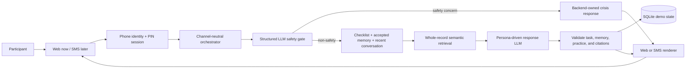

# Reentry Text Companion — Technical One-Pager

**Status:** Implemented hackathon vertical slice
**Scope:** An iMessage-style web demo for adults returning to their communities after incarceration. The core is channel-neutral so an SMS provider can be added later without replacing the conversation, checklist, memory, retrieval, or safety logic.

## Architecture



Stack: Next.js 16 + TypeScript, SQLite, Zod, the OpenAI Responses API with `gpt-6-luna` for chat and safety classification, local `embeddinggemma` with lexical fallback for retrieval, Vitest, and Playwright. Strict Structured Outputs preserve the existing typed backend contract. No agent framework is needed for this bounded pipeline.

## Conversation behavior

There is no regex or keyword intent router.

1. The server authenticates the known demo phone with a conversational four-digit PIN. The raw PIN bypasses chat history and the LLM.
2. A narrow structured LLM call classifies only current self-harm, harm to others, immediate danger, or a medical emergency.
3. Safety concerns bypass normal generation and use backend-owned 911/988 wording and verified citations.
4. For a non-safety turn, the server supplies the model with the latest message, four recent messages, the full checklist, server-computed eligible task IDs, accepted memories, up to two retrieved resource records, and up to three relevant mindfulness candidates. Reviewed practice instructions stay on the server.
5. The LLM writes a concise participant-facing response and may reference one primary action: a task recommendation, completion confirmation, memory proposal, practice, or human handoff.
6. The server rejects ungrounded IDs, blocked tasks, unapproved citations, sensitive memories, improvised practices, contradictory actions, and responses over the word limit. Empty optional strings are normalized to `null`; other invalid output fails closed without another generation.
7. The validated turn is persisted and rendered for the active channel.

The live safety and assistant prompts are in [`src/modules/model/conversation-prompt.ts`](./src/modules/model/conversation-prompt.ts). The structured Ollama adapter is in [`src/modules/model/ollama-conversation-model.ts`](./src/modules/model/ollama-conversation-model.ts).

## Resource retrieval

The current corpus contains nine normalized, reviewed action guides, including CalFresh, Los Angeles County birth certificates, California ID, Medi-Cal, Social Security benefits, California LifeLine, California record cleaning, Boundless Freedom Project support, and 211.

For the hackathon:

- Each guide is a small coherent record, so the full normalized guide is embedded once with `embeddinggemma`.
- A query retrieves the two strongest semantic matches. The previous active guide carries forward only when the new query retrieves it again, preserving ambiguous follow-ups without contaminating clear topic changes.
- The complete matched records—not just snippets—are sent to the response model.
- The model answers the exact question in at most 30 words and usually gives one next step, not the whole corpus.
- The model returns only resource IDs. The server validates those IDs and attaches the reviewed source URL plus a direct official action URL when available.
- If the records do not support an answer, the model must say so instead of guessing.

Section-level chunking is deliberately postponed. Add it when longer documents enter the corpus or whole-record retrieval loses precision; it is unnecessary for the current nine compact guides.

Source routing and normalized content live in [`content/retrieval-manifest.json`](./content/retrieval-manifest.json) and [`content/resource-guides.json`](./content/resource-guides.json).

## Checklist and memory

Checklist items are database records with status, phase, priority, and prerequisite IDs. The backend computes which tasks are eligible. The LLM sees that state and uses the participant’s accepted constraints to choose the most practical eligible task; the backend validates the choice before rendering it. Only the explicit completion endpoint changes checklist state.

Memory is opt-in. The LLM receives only accepted memories. A new safe preference, goal, constraint, language, or contact preference becomes a proposal only when the participant asks the system to remember it. The participant must then approve it. PINs, passwords, identity numbers, addresses, payment data, and medical or legal details are rejected.

## Mindfulness

All 21 adapted one-minute practices are available as structured records from [`content/mindfulness-practices.json`](./content/mindfulness-practices.json).

The LLM selects a practice ID from the reviewed catalog based on the latest message. It may write only a short empathetic transition. The backend appends the exact reviewed instruction, a `🌿` cue, and a compact opt-out while keeping the complete message within 30 words. An explicit “not now” is respected, and an older distress message cannot force mindfulness into a new practical request.

No local meditation-app link is emitted because this repository does not implement that player.

## Safety and human support

Boundless Freedom Project is not represented as a crisis service. For current danger, the backend response directs the participant to 911 and/or 988 using fixed reviewed language. The web demo shows ordinary message text rather than a custom crisis card that native iMessage or SMS could not deliver.

A human handoff is demo-only and clearly states that no staff member was contacted. A production handoff needs participant consent, a staff-owned queue, delivery status, service hours, escalation policy, and reviewed copy.

## Channel boundary

Both web and future SMS adapters call the same core function:

```ts
type IncomingTurn = {
  idempotencyKey: string;
  channel: "web" | "sms";
  participantId: string;
  text: string;
  receivedAt: string;
};

type TurnResult = {
  text: string;
  actions: ConversationAction[];
  citations: Citation[];
};
```

The core returns channel-neutral text, action metadata, and citations. The current web renderer produces the iMessage-style demo. The existing SMS renderer produces bounded plain-text segments with URLs. A real SMS integration still needs provider webhook signature verification, E.164 sender mapping, idempotency, persisted pending confirmations, delivery-status handling, consent, quiet hours, and STOP/START/HELP processing outside the LLM.

## Minimal API

| Endpoint | Purpose |
|---|---|
| `POST /api/auth/pin` | Verify the demo PIN and create a session |
| `GET /api/bootstrap` | Load participant, messages, tasks, and feature flags |
| `POST /api/chat/messages` | Process one idempotent conversation turn |
| `POST /api/tasks/:id/complete` | Confirm task completion |
| `POST /api/memories/:id/decision` | Accept or reject a memory proposal |
| `POST /api/demo/morning` | Simulate a proactive check-in |
| `POST /api/demo/reset` | Restore fictional demo state |
| `GET /api/health` | Verify runtime dependencies |

## Demo boundary and next steps

- The participant and phone number are fictional.
- The official guides are source-backed and dated, but the directory is not comprehensive.
- BFP-authored practice adaptations and crisis/handoff copy still need organizational review before a pilot.
- The local 14B model produces stronger checklist and retrieval behavior but has roughly 10–13 second warm-turn latency on the current machine; the first cold turn may take about 25 seconds.
- Before a pilot: add a real messaging provider, human handoff operations, content review/expiry workflows, accessibility and Spanish review, adversarial safety evaluations, and audit/retention policies.

## Verification

```bash
pnpm test
pnpm build
pnpm test:e2e
pnpm demo:preflight
```

Current automated result: 82 unit/integration tests pass, the production build succeeds, and preflight confirms the 14B model, database, embeddings, checklist, and 21-practice catalog are ready.
